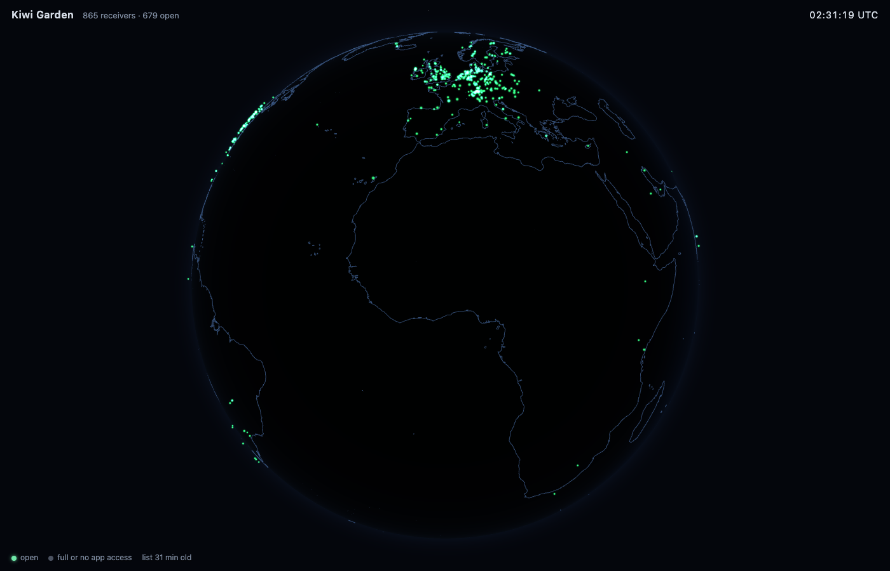

and the no# Kiwi Garden

Kiwi Garden is a local program that lets you listen to live shortwave through
any of the ~870 public [KiwiSDR](https://kiwisdr.com) receivers in the world,
from a map, without your browser ever touching one of them. A small Go binary
runs on your machine. It fetches the receiver list once a day over HTTPS,
speaks the KiwiSDR WebSocket protocol to whichever receiver you click,
decodes the receiver's ADPCM audio stream into PCM, and hands that to a page
it serves on `127.0.0.1`. The page draws the receivers on a globe with a live
day/night terminator. The browser talks to the relay and nothing else.



Security design and the adversarial reviews live in
[THREAT_MODEL.md](THREAT_MODEL.md); the working notes from reverse-engineering
the protocol and building each layer are in `docs/`.

## 1. What a KiwiSDR actually sends you

A KiwiSDR is a BeagleBone with a 14-bit, 66.666 MHz ADC on a cape that
digitises 0 to 30 MHz directly. The FPGA decimates that into up to eight
independent receiver channels, and the ARM side runs the demodulators and
a web server. Every public Kiwi is a web page, and the page's audio comes
over a WebSocket. There is no documented client API; there is the browser
JavaScript, and there is `kiwiclient`, a Python program that the Kiwi author
maintains and that most third-party tools are built on.

`kiwiclient` has no license file and its protocol module has no license
header, so this project ports none of it. The protocol below was learned by
reading it and the server source (`rx/rx_sound.cpp`, `rx/rx_cmd.cpp`,
`rx/rx_server.cpp` in `jks-prv/KiwiSDR`), then re-implemented and verified
against live receivers. The full notes are in [docs/PHASE0.md](docs/PHASE0.md),
including what each receiver said when it refused us.

### The handshake

You open a WebSocket to `/<unix_seconds>/SND` on the receiver. The browser UI
uses `/kiwi/<ts>/SND`; the bare `<ts>/SND` form is what `kiwirecorder` uses,
and the server pattern-matches it (`rx_server.cpp`, `isKrec`) to classify
the connection as a non-browser client. That matters: the receiver's admin
can set a separate channel limit for "non-Kiwi apps", and if it is zero the
server simply allocates nothing and sends nothing. Kiwi Garden uses the
`kiwirecorder` form on purpose, so that an operator who said no to apps gets
a no.

On allocation the server immediately sends `MSG sample_rate=11998.992692`.
That number is not 12000 because the Kiwi disciplines its ADC clock against
GPS and reports the true decimated rate; the client is expected to resample
to its own output clock. Then the client authenticates:

```
SET auth t=kiwi p=
```

(empty password for a public receiver). The reply is a burst of `MSG` lines:
`client_public_ip`, `rx_chans=8`, `chan_no_pwd`, `badp=0` (which means
*success*; `badp=1` through `7` are the rejection codes), firmware version,
`freq_offset`, a few kilobytes of URL-encoded JSON config in `load_cfg` that
the relay never parses, and `audio_rate=12000`, the nominal rate. The client
acknowledges that with `SET AR OK in=12000 out=44100` and configures the
channel:

```
SET squelch=0 max=0
SET genattn=0
SET gen=0 mix=-1
SET ident_user=Kiwi%20Garden%20(github.com/s0undsystem/KiwiGarden)
SET mod=am low_cut=-4900 high_cut=4900 freq=9420.000
SET agc=1 hang=0 thresh=-100 slope=6 decay=1000 manGain=50
SET keepalive
```

Frequencies are in kHz, passbands in Hz relative to the carrier. `ident_user`
is what shows up in the operator's user list and log; the server parses it
with `sscanf("%256ms")`, so it stops at the first whitespace, hence `%20`.
After that you must send `SET keepalive` at least every 60 seconds
(`KEEPALIVE_SEC` in `kiwi.h`) or the channel is reclaimed. Retuning is just
another `SET mod=...` on the same socket.

### The audio frame

Audio arrives as binary WebSocket messages tagged `SND`:

```
offset  size  field
0       3     "SND"
3       1     flags
4       4     sequence number, little-endian
8       2     S-meter, big-endian, (dBm + 127) * 10
10      ...   audio payload
```

Yes, one little-endian and one big-endian field in a ten-byte header. The
S-meter is in every frame, which is why the signal strength indicator in the
player will be driven by the stream itself rather than a side channel. The
flags byte (`rx_sound.cpp`) tells you how to read the payload:

| bit | meaning |
| --- | --- |
| 0x01 | low-pass filter changed |
| 0x02 | ADC overflow |
| 0x04 | first frame after a retune |
| 0x08 | stereo (IQ or DRM); a 10-byte GPS timestamp follows the header |
| 0x10 | payload is IMA ADPCM |
| 0x20 | decoder state was reset |
| 0x40 | squelch closed |
| 0x80 | PCM is little-endian (default is big-endian) |

By default the payload is IMA ADPCM: 4 bits per sample, two samples per byte,
low nibble first, 1024 bytes per frame, 2048 samples, 5.86 frames a second at
12 kHz. That is about 6 KB/s per listener instead of 24 KB/s for 16-bit PCM,
which is the whole reason a receiver on a residential uplink can serve eight
people. IMA ADPCM is a predictor with an adaptive step size: each nibble
encodes the sign and magnitude of the difference from the previous sample as
a fraction of the current step, and the nibble also moves an index into an
89-entry step table. The decoder has two words of state, the index and the
predicted sample, and they persist across frames. If a frame is lost, the
decoder drifts until the next reset. If a frame is *hostile*, a naive decoder
indexes out of the table. Mine clamps the index to `[0, 88]` and the
predictor to `int16` on every sample (`internal/kiwi/adpcm.go`), and a fuzz
target feeds it random bytes and random preset state.

The important subtlety, found live: the compressed flag must be honoured per
frame. After `SET compression=0` the first frame still arrives compressed,
because the command has not been processed yet. A client that trusts what it
asked for instead of what the frame says plays one frame of noise. A hostile
receiver could flip the flag every frame, so the flag is the only truth.

### How receivers say no

| condition | what you see |
| --- | --- |
| public channels full | handshake completes, then `badp=1`, connection stays open |
| every channel full | `MSG too_busy=8` |
| admin configured an overflow URL | `MSG redirect=http...` |
| app channels disallowed or exhausted | handshake completes, then **nothing, ever** |
| a reverse proxy in front | `HTTP 403` to the upgrade |
| server down or updating | `MSG down` |

The silent case is the one that bites. The receiver allocated no channel,
returned early, and left the socket open. A client without a
first-message timeout holds that socket forever and so does the receiver.
Kiwi Garden gives a receiver ten seconds to say anything after the upgrade.

### Origin and TLS

Receivers do not check the `Origin` header at all. The only place the server
touches it is to emit `Access-Control-Allow-Origin: *`. A session with
`Origin: http://evil.example` ran to completion. Combined with the fact that
two of 870 receivers offer TLS and 402 of them sit behind the project's own
HTTP reverse proxy, this means any web page you visit could, in principle,
open a WebSocket to a Kiwi and listen through your IP. It also means a
browser-only Radio Garden clone would be a mixed-content, cross-origin mess.
Both are reasons the relay exists.

## 2. The receiver list, and why it comes from a CDN

The canonical list is `http://kiwisdr.com/public/`. It is served by
lighttpd over plain HTTP; port 443 is closed on `kiwisdr.com`,
`rx.kiwisdr.com` and `www.kiwisdr.com`. In 2026 it sits behind a
click-to-reveal interstitial: the page's JavaScript sends a scripted GET with
an `x-kiwi-auth` header containing a per-page token, the server unlocks that
client IP, and the real list is served on the next request. The maintainer
added this after third-party apps scraped the page per user and per view,
and in [AetherSDR issue #5447](https://github.com/aethersdr/AetherSDR/issues/5447)
asked them to stop and to pull from a single mirror instead. He put an
authenticated HTTPS source at `files.kiwisdr.com` for that mirror.

So the honest options are: replay the interstitial from every user's
machine over plaintext, which is exactly what was asked not to happen, or
use the mirror. Kiwi Garden uses the mirror:
`https://cdn.aethersdr.com/kiwi.json`, a Cloudflare-fronted JSON document
with `schema: 1`, refreshed hourly, 0.8 MB for 870 receivers, with the
operator email that each receiver's own `/status` endpoint exposes already
stripped. The relay fetches it at most once a day and caches it on disk.

That makes a third party the root of the allowlist, and the threat model
says so in plain words. The design response is to never trust it. Every
entry's URL is parsed against a strict grammar (scheme `http`/`https`, LDH
hostname or IP literal, no path, no query, no userinfo, port 80, 443 or
1024+). IP literals are checked against the public-address policy at parse
time. Names, locations and antenna strings are stripped of every Unicode
control and format character (the live list contains U+2063 invisible
separators today; bidi overrides are the obvious next step for someone
having fun) and capped by rune count. The browser never receives a
receiver's URL at all, only a 64-bit ID derived from it. And the connection
itself goes through the dialer described next, which does not care what the
list said.

Half the receivers are listed as `http://<name>.proxy.kiwisdr.com` with no
port. That host answers port 80 with a 307 to port 8073 on itself. The relay
never follows redirects, so it rewrites that one documented case to `:8073`
and connects directly.

## 3. The relay is a firewall with a decoder in it

### Dialing

The attack that matters for a local service that dials hostnames on request
is DNS rebinding: a name in the list resolves to a public address when you
validate it and to `127.0.0.1` or `192.168.1.1` when you connect. Checking
the IP before the dial does not help. `internal/netpolicy` installs a
`net.Dialer.Control` hook, which Go calls with the concrete `ip:port` after
resolution, for every connection attempt, before `connect(2)`. The hook
refuses loopback, RFC 1918, link-local, CGNAT (100.64/10), multicast,
broadcast, the documentation and benchmarking ranges, and the IPv6
equivalents including ULA, site-local, Teredo, 6to4 and the discard prefix.
IPv4-mapped and NAT64 addresses are unwrapped and the embedded IPv4 is
judged. Ports other than 80, 443 and 1024+ are refused. A table-driven test
covers 55 addresses and a live test proves a listener on `127.0.0.1` is
unreachable through the production dialer by IP and by name.

The same dialer is used for the directory fetch, with the extra rule that
the only hostname it may dial is `cdn.aethersdr.com`.

### The WebSocket code is written here, not imported

There is no WebSocket in the Go standard library, and the popular libraries
are fine, but this is the one place where every length field comes from a
hostile peer and the point of the project is to be deliberate about it.
`internal/kiwiws` is a minimal RFC 6455 implementation, about 500 lines
for client and server: it rejects RSV bits (no extensions are negotiated),
rejects control frames over 125 bytes or fragmented, rejects 64-bit lengths
with the high bit set, checks every declared length against the remaining
budget *before* allocating, caps reassembled fragmented messages, and
tolerates masked server frames because the bytes are untrusted either way.
A fuzz target drives the frame reader with arbitrary bytes.

### The session

`internal/relay` owns one receiver connection per browser session. It
enforces: at most three sessions, one per receiver hostname (so 400
receivers behind the shared proxy IP are still distinct), 90 minutes per
session, 256 MiB from the receiver, 512 KiB/s inbound averaged over two
seconds, a 10 s first-message timeout, a 15 s inter-message timeout, a 5 s
write deadline in both directions, a 256 KiB message cap, a 64 KiB audio
payload cap, and a sample-rate allowlist of 12000 and 20250 Hz within one
percent (the `rx3.wf3` FPGA configuration runs at 20.25 kHz). Every exit path
sends a close frame to the receiver so the channel is freed immediately
rather than after the keepalive timeout. A failed or refused receiver gets
exponential backoff, 5 s doubling to 10 min, cleared after 30 s of good
audio; attempts during backoff are refused locally without touching the
network.

All of that is tested against `internal/mockkiwi`, a receiver impersonator
with 23 behaviours: a frame that declares 16 MiB, a frame that declares 4000
bytes and sends 100, one byte every two seconds, random bytes with an `SND`
tag mid-stream, an HTTP 307, a 200 KiB metadata value, silence after the
handshake, every busy code, a 48 kHz sample rate, a flood, masked frames,
RSV bits, reserved opcodes, a stereo frame that was never requested, odd-length
PCM, and a sequence number that jumps to 2^32. Each has to end in a clean
close with a machine-readable reason, and a separate test runs rounds of
them concurrently and checks that the goroutine count returns to baseline.

### The local server

The relay binds `127.0.0.1` (never `0.0.0.0`, never `localhost`, which can
resolve to more than one thing). Every request must carry a `Host` header
equal to the bound `127.0.0.1:<port>`, which is the simplest complete defence
against rebinding at this layer. `Origin`, when present, must equal
`http://127.0.0.1:<port>` exactly; on the WebSocket upgrade it is mandatory,
because browsers always send it there. `Sec-Fetch-Site` must be
`same-origin` for API routes. There are no CORS headers of any kind. Every
response carries `X-Content-Type-Options: nosniff`, `Referrer-Policy:
no-referrer`, `Cross-Origin-Opener-Policy: same-origin`,
`Cross-Origin-Resource-Policy: same-origin` and `X-Frame-Options: DENY`.

Then there is the session token, because `Origin` checks protect against
other pages but not against another process on your machine. At startup the
relay draws 32 bytes from `crypto/rand` and prints one URL:

```
http://127.0.0.1:62758/#e62cb4bc...
```

The token is in the fragment. Browsers never send the fragment to the
server, so it is absent from any log. The page moves it into
`sessionStorage`, which is scoped to the origin *including the port* (unlike
cookies, which ignore ports, which is why there are no cookies anywhere in
this design), and strips it from the address bar. API calls send it in an
`X-Kiwi-Token` header; the WebSocket sends it as the first message, within
five seconds, before anything else is accepted. Comparison is
`crypto/subtle.ConstantTimeCompare`. A token in a query string is ignored.

Everything the browser can send is bounded: 4 KiB per message, 20 messages
a second, unknown JSON fields rejected, frequencies clamped to 0 to 30000
kHz, modes to `am`, `usb`, `lsb`, `cw`. The browser cannot name a host; it
names an ID that must exist in the current validated list.

## 4. The page

The front end is TypeScript on three.js, built by Vite into one hashed
script and embedded in the Go binary with `go:embed`. What matters about it
is what it cannot do. It runs under `default-src 'self'; script-src 'self';
connect-src 'self'; frame-ancestors 'none'; base-uri 'none'; object-src
'none'; require-trusted-types-for 'script'; trusted-types kg`: no inline
script, no `eval`, no `innerHTML`, no request to any host but the relay,
and exactly one Trusted Types policy, which accepts exactly one script URL
(the audio worklet). A test scans the built bundle for URLs and DOM sinks;
the only URL-shaped strings in 550 KB of three.js are the XHTML namespace
and a citation comment. Every string from the relay reaches the DOM through
`textContent`. The page does not know a receiver's URL and has no way to
link to, embed or open one.

Audio playback is an `AudioWorkletProcessor` (`web/public/player-worklet.js`)
fed int16 PCM at the receiver's calibrated rate. It keeps a four-second ring
buffer, starts after 250 ms is buffered, and then chases a 300 ms target by
nudging the resampling ratio by at most one percent, which absorbs the
receiver's clock offset and network jitter without ever skipping. Underruns
and receiver switches ramp the gain over 5 ms instead of muting, so a stall
is a dip and a retune is the receiver's own filter transient, which is the
honest sound of tuning a radio. A peak limiter (1 ms attack, 250 ms release,
ceiling at -1 dBFS) and a hard clamp sit at the end of the chain so that a
receiver with its AGC off cannot hand you full-scale square waves. The
S-meter in the UI is the S-meter field from each audio frame, nothing more.

The logbook lives in `localStorage` and is treated as hostile when read
back: every field is type-checked and capped, the receiver is referenced by
ID and re-resolved against the current list, and export is a `blob:`
download that needs no CSP exception.

## 5. Being a reasonable guest

Public KiwiSDRs are volunteer hardware on home connections. The relay
identifies itself honestly in `ident_user` and `User-Agent`, uses the
connection form that subjects it to the operator's app limit, sends one
keepalive a second, closes cleanly, backs off after any refusal, holds one
connection per receiver, caps sessions at 90 minutes so a forgotten tab does
not sit on a channel all night, and never polls receivers' `/status`
endpoints (that would be 870 requests to volunteer hardware per refresh; the
mirror's hourly snapshot is good enough and the receiver's own `badp=1` is
the ground truth).

## 6. Building and running

```sh
make build        # npm ci + vite build into internal/ui/dist, then go build
./kiwi-garden     # prints the one-time URL
```

Flags: `-port N`, `-no-cache`, `-v`. `make test` runs `go vet` and the full
suite (the relay suite takes ~20 s because it waits for real timeouts);
`make fuzz` runs the six fuzz targets briefly.

Go dependencies: none outside the standard library. Web dependencies, pinned
exactly: `three` 0.186.1 at runtime; `vite` 8.3.4, `typescript` 5.9.3,
`@types/three` 0.186.0 at build time. `globe.gl` was rejected because it
drags in d3 and fetches textures from a CDN by default.

```
cmd/kiwi-garden     entry point
cmd/kiwispike       debugging CLI: one receiver, one frequency, N seconds to a WAV
internal/netpolicy  address policy and the Control-hook dialer
internal/directory  list fetch, validation, cache
internal/kiwiws     RFC 6455 client and server
internal/kiwi       SND/MSG parsing, IMA ADPCM
internal/relay      sessions, limits, backoff
internal/server     the 127.0.0.1 front door
internal/sanitize   Unicode cleaning for untrusted strings
internal/mockkiwi   the hostile receiver
internal/ui         embedded build output
web/                TypeScript + three.js
```

## 7. Sources

- `jks-prv/kiwiclient` and `jks-prv/KiwiSDR` on GitHub, read for the protocol.
- AetherSDR issue #5447 for the state of the public directory.
- Natural Earth for the coastlines.
- RFC 6455 for the WebSocket framing; the IMA ADPCM reference tables.
